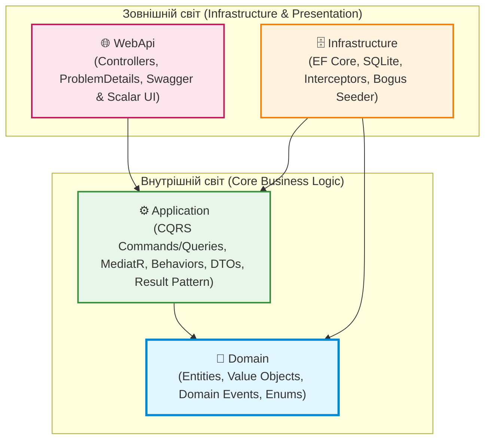

# 🎓 Навчальний репозиторій: Clean Architecture на .NET 10

[](https://dotnet.microsoft.com/)
[](https://docs.microsoft.com/en-us/dotnet/csharp/)
[](https://blog.cleancoder.com/uncle-bob/2012/08/13/the-clean-architecture.html)
[](https://github.com/jbogard/MediatR)
[](https://learn.microsoft.com/en-us/ef/core/)
[](https://github.com/bchavez/Bogus)

> **Натхненний класичним шаблоном Джейсона Тейлора ([jasontaylordev/CleanArchitecture](https://github.com/jasontaylordev/CleanArchitecture)).**  
> Цей репозиторій створений як **ідеальний практичний посібник** для розробників, які бажають розібратися в сучасній архітектурі enterprise-додатків на .NET без магії, зайвого оверхеду та без .NET Aspire.

---

<a id="toc"></a>
## 📑 Швидка навігація по README

- [📚 Матеріали курсу в цьому репозиторії](#materials)
- [🎯 Навчальні цілі проекту](#goals)
- [🏛️ Візуальна схема архітектури](#diagram)
- [🗺️ Навігація по коду: Що і де дивитися студенту?](#code-nav)
- [🚀 Швидкий старт](#quickstart)
- [🧪 Сценарії для перевірки знань (Практикум)](#practice)
- [🛠️ Практичне завдання: Як додати нову фічу?](#homework)
- [🤝 Структура файлів рішення Visual Studio](#solution-structure)

---

<a id="materials"></a>
## 📚 Матеріали курсу в цьому репозиторії

У папці `docs/` та корені рішення для вас підготовлені повноцінні навчальні матеріали з повною клікабельною навігацією:

| Документ | Опис | Швидкий перехід |
| :--- | :--- | :--- |
| 📊 **Архітектурний Майстер-клас** | Повна інтерактивна презентація з **26 слайдів-розділів**: аналогії, проблеми, схеми, таблиці та код | ➡️ [docs/Architecture-Presentation.md](docs/Architecture-Presentation.md#toc) |
| 📡 **Довідник по MediatR** | Детальний аналіз інтерфейсів `ISender`, `IPublisher`, `IMediator`, `IRequest`, `INotification` та конвеєрів | ➡️ [docs/MediatR-Guide.md](docs/MediatR-Guide.md#toc) |
| 💻 **Вихідний код проекту** | Готове працююче рішення з детальними XML- та inline-коментарями до кожного класу | ➡️ [`src/`](src/) |

[⬆ До змісту](#toc)

---

<a id="goals"></a>
## 🎯 Навчальні цілі проекту

Вивчивши цей репозиторій, ви розберетеся в ключових темах сучасної архітектури:

1. **Правило залежностей (The Dependency Rule):** Чому ядро бізнес-логіки не повинно знати про базу даних чи HTTP.  
   👉 *Читати:* [Слайди 1–3 у презентації](docs/Architecture-Presentation.md#slide-1)
2. **Domain-Driven Design (DDD) & Value Objects:** Чому одержимість примитивами (Primitive Obsession) — це зло, і як об'єкти-значення захищають бізнес-правила.  
   👉 *Читати:* [Слайди 6–8 у презентації](docs/Architecture-Presentation.md#slide-6)
3. **CQRS (Command Query Responsibility Segregation):** Чому моделі для читання та моделі для запису мають бути різними.  
   👉 *Читати:* [Слайди 12–14 у презентації](docs/Architecture-Presentation.md#slide-12)
4. **MediatR & Pipeline Behaviors:** Як будувати наскрізні конвеєри обробки (логування, валідація FluentValidation, моніторинг часу) за принципом «матрьошки».  
   👉 *Читати:* [Слайди 15–19 у презентації](docs/Architecture-Presentation.md#slide-15) | [Довідник MediatR](docs/MediatR-Guide.md#part-4)
5. **Entity Framework Core Fluent API:** Як мапити Value Objects через `HasConversion` та `OwnsOne`, використовувати Interceptors замість перевантаження методів.  
   👉 *Читати:* [Слайди 9 та 11 у презентації](docs/Architecture-Presentation.md#slide-9)
6. **Result Pattern:** Як відмовитися від повільних та небезпечних винятків (`Exceptions for Flow Control`) на користь явних та швидких результатів `Result<T>`.  
   👉 *Читати:* [Слайди 20–22 у презентації](docs/Architecture-Presentation.md#slide-20)
7. **Реалістичний сидинг через Bogus:** Як наповнювати базу багатими україномовними даними з детермінованим зерном.  
   👉 *Читати:* [Слайд 23 у презентації](docs/Architecture-Presentation.md#slide-23)

[⬆ До змісту](#toc)

---

<a id="diagram"></a>
## 🏛️ Візуальна схема архітектури



[⬆ До змісту](#toc)

---

<a id="code-nav"></a>
## 🗺️ Навігація по коду: Що і де дивитися студенту?

### 1. 💎 Слой Domain (Ядро предметної області)
Повна ізоляція: 0 залежностей від баз даних чи веб-серверів.
- [src/Domain/Common/ValueObject.cs](src/Domain/Common/ValueObject.cs) — базовий клас равенства по значенню (`GetEqualityComponents`, перевантаження `==`, `!=`).
- [src/Domain/ValueObjects/Colour.cs](src/Domain/ValueObjects/Colour.cs) — одинарний Value Object із фабричним методом `From()` та захистом допустимих кольорів.
- [src/Domain/ValueObjects/Address.cs](src/Domain/ValueObjects/Address.cs) — комплексний Value Object фізичної адреси.
- [src/Domain/Entities/TodoItem.cs](src/Domain/Entities/TodoItem.cs) — багата доменна модель (метод `MarkComplete()` автоматично генерує доменну подію).
- [src/Domain/Events/TodoItemCompletedEvent.cs](src/Domain/Events/TodoItemCompletedEvent.cs) — доменна подія (`INotification`).

### 2. ⚙️ Слой Application (Бізнес-сценарії / Use Cases)
Залежить тільки від `Domain`. Реалізує CQRS та шину MediatR.
- [src/Application/Common/Models/Result.cs](src/Application/Common/Models/Result.cs) — реалізація Result Pattern (`Result<T>`, `Error`, `ErrorType.NotFound` тощо).
- [src/Application/Common/Behaviors/ValidationBehavior.cs](src/Application/Common/Behaviors/ValidationBehavior.cs) — перехоплювач конвеєра, що запускає FluentValidation до виклику хендлера (**Short-Circuiting**).
- [src/Application/Common/Behaviors/LoggingBehavior.cs](src/Application/Common/Behaviors/LoggingBehavior.cs) та [PerformanceBehavior.cs](src/Application/Common/Behaviors/PerformanceBehavior.cs) — AOP-логування та моніторинг швидкодії.
- [src/Application/TodoLists/Queries/GetTodoLists/GetTodoListsQueryHandler.cs](src/Application/TodoLists/Queries/GetTodoLists/GetTodoListsQueryHandler.cs) — приклад швидкого читання (`AsNoTracking()`, проекція `Select` у DTO).
- [src/Application/TodoLists/Commands/CreateTodoList/CreateTodoListCommandHandler.cs](src/Application/TodoLists/Commands/CreateTodoList/CreateTodoListCommandHandler.cs) — команда зміни стану агрегату.
- [src/Application/TodoItems/Queries/GetTodoItemById/GetTodoItemByIdQuery.cs](src/Application/TodoItems/Queries/GetTodoItemById/GetTodoItemByIdQuery.cs) — демонстрація використання Result Pattern замість `NotFoundException`.

### 3. 🗄️ Слой Infrastructure (База даних та адаптери)
Реалізація інтерфейсів `Application` через Entity Framework Core та SQLite.
- [src/Infrastructure/Data/Configurations/TodoListConfiguration.cs](src/Infrastructure/Data/Configurations/TodoListConfiguration.cs) — Fluent API налаштування:
  - `HasConversion` для Value Object `Colour`;
  - `OwnsOne` для комплексного Value Object `Address`.
- [src/Infrastructure/Data/Interceptors/AuditableEntityInterceptor.cs](src/Infrastructure/Data/Interceptors/AuditableEntityInterceptor.cs) — перехоплювач для автоматичного заповнення дат `CreatedAtUtc` та `LastModifiedAtUtc`.
- [src/Infrastructure/Data/Interceptors/DispatchDomainEventsInterceptor.cs](src/Infrastructure/Data/Interceptors/DispatchDomainEventsInterceptor.cs) — автоматична публікація доменних подій після фіксації транзакції (`SaveChangesAsync`).
- [src/Infrastructure/Data/Seeding/ApplicationDbContextInitialiser.cs](src/Infrastructure/Data/Seeding/ApplicationDbContextInitialiser.cs) — реалістична генерація тестових даних українською мовою через бібліотеку **Bogus**.

### 4. 🌐 Слой WebApi (Точка входу та HTTP-контракти)
- [src/WebApi/Controllers/ApiControllerBase.cs](src/WebApi/Controllers/ApiControllerBase.cs) — тонкий контролер з `ISender` та методом `HandleResult()` для автоматичного мапінгу `Result<T>` у відповіді ProblemDetails (RFC 7807).
- [src/WebApi/Controllers/TodoListsController.cs](src/WebApi/Controllers/TodoListsController.cs) та [TodoItemsController.cs](src/WebApi/Controllers/TodoItemsController.cs) — REST API ендпоінти.
- [src/WebApi/Middleware/ExceptionHandlingMiddleware.cs](src/WebApi/Middleware/ExceptionHandlingMiddleware.cs) — централізований обробник аварійних винятків.
- [src/WebApi/Program.cs](src/WebApi/Program.cs) — конфігурація DI, запуск Seeder та підключення інтерактивних UI Swagger і Scalar.

[⬆ До змісту](#toc)

---

<a id="quickstart"></a>
## 🚀 Швидкий старт

### 1. Передумови
Встановлений SDK: **.NET 10** (або .NET 8/9).
```bash
dotnet --version
```

### 2. Запуск програми
У кореневій директорії репозиторію виконайте:
```bash
dotnet run --project src/WebApi
```

### 3. Що станеться автоматично при першому старті:
1. EF Core створить локальний файл бази даних SQLite `CleanArchitecture.db`.
2. Бібліотека **Bogus** згенерує детермінований набір із 5 детальних списків та понад 20 завдань українською мовою.
3. Додаток почне слухати запити на локальному порту:
```
info: Infrastructure.Data.Seeding.ApplicationDbContextInitialiser[0]
      Успішно згенеровано та збережено 5 списків та 24 завдань через Bogus!
info: Microsoft.Hosting.Lifetime[14]
      Now listening on: http://localhost:5194
```

### 4. Інтерактивна документація API (Swagger & Scalar UI)
Відкрийте браузер за адресою:  
👉 **`http://localhost:5194`** (автоматичний редирект на Swagger UI)  

Доступні два зручні інтерфейси для тестування ендпоінтів:
- 📑 **Swagger UI:** [`http://localhost:5194/swagger`](http://localhost:5194/swagger)
- 🌟 **Scalar API UI:** [`http://localhost:5194/scalar/v1`](http://localhost:5194/scalar/v1)
- 📄 **OpenAPI специфікація JSON:** [`/swagger/v1/swagger.json`](http://localhost:5194/swagger/v1/swagger.json) та [`/openapi/v1.json`](http://localhost:5194/openapi/v1.json)

[⬆ До змісту](#toc)

---

<a id="practice"></a>
## 🧪 Сценарії для перевірки знань (Практикум)

| Що протестувати | Як виконати | Що спостерігати |
| :--- | :--- | :--- |
| **1. Швидке читання (CQRS Query)** | `GET /api/todolists` | Отримання списків з їхніми кольорами (Colour) та адресами (Location). У логах видно чистий SQL без відстеження змін ChangeTracker. |
| **2. Result Pattern (Успіх)** | `GET /api/todoitems/1` | Отримання завдання з `Id = 1`, повертається статус `200 OK` через `HandleResult()`. |
| **3. Result Pattern (Запис відсутній)** | `GET /api/todoitems/999` | Повертається `404 Not Found` з детальним JSON ProblemDetails. **При цьому в коді не було викинуто жодного Exception!** |
| **4. Валідація FluentValidation** | `POST /api/todolists` із `{ "title": "", "colour": "#INVALID" }` | Конвейер `ValidationBehavior` блокує запит до виклику хендлера і повертає `400 Bad Request` зі списком помилок за полями. |
| **5. Доменна подія (Domain Event)** | `PUT /api/todoitems/1` із `{ "done": true }` | При зміні статусу на `done: true` у консолі з'являється лог: `ДОМЕННА ПОДІЯ: Завдання позначено як виконане!`. |

[⬆ До змісту](#toc)

---

<a id="homework"></a>
## 🛠️ Практичне завдання: Як додати нову фічу?

Спробуйте самостійно додати до проекту сутність **`Category` (Категорія)**:
1. **Domain:** Створіть `Domain/Entities/Category.cs`, успадкуйте від `BaseAuditableEntity`.
2. **Infrastructure:** Створіть `Infrastructure/Data/Configurations/CategoryConfiguration.cs` та додайте `DbSet<Category>` у `IApplicationDbContext` і `ApplicationDbContext`.
3. **Application:** Створіть команду `CreateCategoryCommand` з валідатором `CreateCategoryCommandValidator` та обробником `CreateCategoryCommandHandler`.
4. **WebApi:** Створіть `CategoriesController`, що успадковує `ApiControllerBase`.

[⬆ До змісту](#toc)

---

<a id="solution-structure"></a>
## 🤝 Структура файлів рішення Visual Studio

Рішення організовано у файлі **`AspNet-CleanArchitecture.sln`**.  
У Visual Studio або JetBrains Rider ви побачите зручні папки рішення (Solution Folders):
- 📁 **`src/`** — чотири проекти архітектури (`Domain`, `Application`, `Infrastructure`, `WebApi`).
- 📁 **`docs/`** — презентація `Architecture-Presentation.md` та довідник `MediatR-Guide.md`.
- 📁 **`Solution Items/`** — `README.md`, `.gitignore`, `.gitattributes`.

[⬆ До змісту](#toc)

---

*Приємного вивчення та чистого коду! 🚀*
