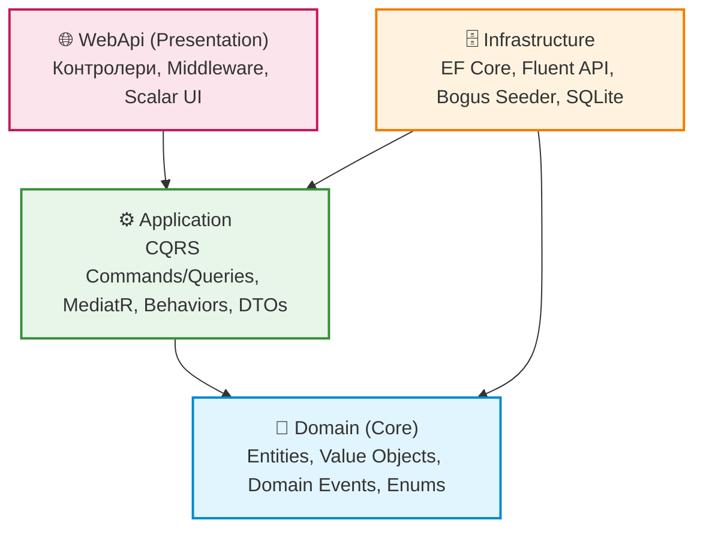

# 🏛️ Навчальний проект Clean Architecture на .NET

> **Натхненний популярним шаблоном Джейсона Тейлора ([jasontaylordev/CleanArchitecture](https://github.com/jasontaylordev/CleanArchitecture)).**  
> Проект розроблений як максимально прозорий, модульний та детально задокументований навчальний зразок, де **кожен клас, метод та патерн пояснено детальними україномовними коментарями**.

---

## 📌 Основні технології та концепції

- **.NET 10** (C# 13 / 14)
- **Чиста архітектура (Clean Architecture)**: 4 ізольованих шари (`Domain`, `Application`, `Infrastructure`, `WebApi`).
- **CQRS (Command Query Responsibility Segregation)**: поділ операцій на читання (Queries) та зміну стану (Commands).
- **MediatR**: внутрішньопроцесна шина повідомлень + конвеєри поведінки (**Pipeline Behaviors** для валідації, логування та моніторингу швидкодії).
- **FluentValidation**: декларативна валідація бізнес-правил без засмічення хендлерів.
- **Об'єкти-значення (Value Objects)**: незмінні типи предметної області (`Colour`, `Address`) з порівнянням за значеннями властивостей.
- **Entity Framework Core**:
  - Налаштування схеми БД виключно через **Fluent API** (`IEntityTypeConfiguration<T>`) — ніяких атрибутів у Domain!
  - Демонстрація мапінгу Value Objects через `HasConversion` (для одинарних значень) та `OwnsOne` (для комплексних адрес).
  - Автоматичний аудит дат через **EF Core Interceptor** (`AuditableEntityInterceptor`).
  - Автоматична публікація доменних подій через **Interceptor** (`DispatchDomainEventsInterceptor`).
- **Генератор тестових даних Bogus**: реалістичний сидинг україномовними даними при першому старті.
- **Відсутність .NET Aspire**: проект запускається безпосередньо і не потребує Docker чи зовнішніх сервісів.
- **Scalar / OpenAPI**: сучасний інтерактивний UI для перевірки та тестування ендпоінтів.

---

## 🏗️ Архітектура та правило залежностей (Dependency Rule)

Головний закон чистої архітектури: **зовнішні шари залежать від внутрішніх, але внутрішні шари НІКОЛИ не знають про зовнішні**.



### 1. `src/Domain` (Ядро предметної області)
- **Залежності**: 0 (повна ізоляція від баз даних, фреймворків чи HTTP).
- **Містить**:
  - `BaseEntity` — базовий клас з підтримкою `Id` та реєстрації доменних подій.
  - `BaseAuditableEntity` — властивості для аудиту (`CreatedAtUtc`, `CreatedBy`, `LastModifiedAtUtc`).
  - `ValueObject` — базовий абстрактний клас, що реалізує порівняння за значенням властивостей (`GetEqualityComponents`).
  - `Colour` — Value Object кольору оформлення з перевіркою підтримуваних hex-кодів.
  - `Address` — комплексний Value Object фізичної адреси (вулиця, місто, область, індекс).
  - `TodoList` та `TodoItem` — сутності бізнес-моделі із захистом інваріантів (наприклад, метод `MarkComplete()` піднімає подію).
  - `TodoItemCompletedEvent` — доменна подія завершення завдання.

### 2. `src/Application` (Бізнес-логіка та Use Cases)
- **Залежності**: тільки `Domain`.
- **Містить**:
  - **CQRS Commands**: `CreateTodoList`, `UpdateTodoList`, `DeleteTodoList`, `CreateTodoItem`, `UpdateTodoItem`, `DeleteTodoItem`.
  - **CQRS Queries**: `GetTodoListsQuery`, `GetTodoItemsWithPaginationQuery` (з пагінацією в БД через `Skip`/`Take`).
  - **Pipeline Behaviors (MediatR)**:
    - `LoggingBehavior` — логування кожного запиту.
    - `ValidationBehavior` — автоматичний запуск FluentValidation перед викликом хендлера.
    - `PerformanceBehavior` — замір часу та попередження у лог, якщо запит тривав > 500 мс.
  - **Інтерфейси**: `IApplicationDbContext`, `IDateTimeProvider` (принцип інверсії залежностей).

### 3. `src/Infrastructure` (Робота з базою даних та сервісами)
- **Залежності**: `Application` та `Domain`.
- **Містить**:
  - `ApplicationDbContext` — реалізація контексту EF Core.
  - **Fluent API Configurations**:
    - `TodoListConfiguration` — конфігурація таблиці `TodoLists`, зв'язків та мапінгу Value Objects.
    - `TodoItemConfiguration` — конфігурація таблиці `TodoItems` та індексів.
  - **Interceptors**:
    - `AuditableEntityInterceptor` — автоматично проставляє дати створення/оновлення.
    - `DispatchDomainEventsInterceptor` — публікує накопичені сутностями події через MediatR при виклику `SaveChangesAsync()`.
  - **Bogus Seeder**:
    - `ApplicationDbContextInitialiser` — генерує локалізовані українські списки, завдання, пріоритети та адреси, якщо база порожня.

### 4. `src/WebApi` (Presentation шар)
- **Залежності**: `Application` та `Infrastructure` (Composition Root).
- **Містить**:
  - `ApiControllerBase` — базовий клас з лінивою ініціалізацією `ISender`.
  - Тонкі REST-контролери (`TodoListsController`, `TodoItemsController`), які лише делегують виклик у MediatR.
  - `ExceptionHandlingMiddleware` — централізований обробник винятків у форматі RFC 7807 (ProblemDetails).
  - `Program.cs` — реєстрація сервісів, сидинг та запуск конвеєра.

---

## 🎯 Глибоке занурення в патерни

### 🔹 Entity проти Value Object
| Критерій | Entity (Сутність) | Value Object (Об'єкт-значення) |
| :--- | :--- | :--- |
| **Ідентичність** | Визначається за унікальним `Id`. Дві сутності з різним Id — різні об'єкти, навіть якщо поля збігаються. | Не має Id. Визначається виключно значеннями своїх полів. |
| **Мутабельність** | Може змінювати свій стан з часом (наприклад, завдання змінює назву). | **Незмінний (Immutable)**. При зміні створюється новий об'єкт. |
| **Рівність** | `entity1.Id == entity2.Id` | Порівнюються всі властивості (`GetEqualityComponents()`). |
| **Приклад у проекті** | `TodoList`, `TodoItem` | `Colour` (`#FFFFFF`), `Address` (вулиця, місто, індекс) |

### 🔹 Мапінг Value Objects у EF Core
1. **Одинарні Value Objects (`Colour`)** через `HasConversion`:
   ```csharp
   builder.Property(t => t.Colour)
       .HasConversion(colour => colour.Code, code => Colour.From(code))
       .HasMaxLength(10);
   ```
2. **Комплексні Value Objects (`Address`)** через `OwnsOne`:
   ```csharp
   builder.OwnsOne(b => b.Location, ab =>
   {
       ab.Property(a => a.Street).HasColumnName("Location_Street").HasMaxLength(150);
       ab.Property(a => a.City).HasColumnName("Location_City").HasMaxLength(100);
   });
   ```

### 🔹 CQRS та MediatR Pipeline Behaviors
Замість монолітних сервісів на 1000 рядків, кожна операція — це окремий файл (`Command` або `Query`).
Запит проходить крізь конвеєр поведінки автоматично:
```
HTTP Запит 
   ⬇
[LoggingBehavior]     -> Запис у лог: "Початок обробки CreateTodoListCommand"
   ⬇
[ValidationBehavior]  -> FluentValidation: перевірка унікальності назви, кольору...
   ⬇ (якщо валідація не пройшла -> викидається ValidationException)
[PerformanceBehavior] -> Замір часу виконання (Stopwatch)
   ⬇
[CommandHandler]      -> Чиста бізнес-логіка (без ручних перевірок)
   ⬇
[SaveChanges]         -> AuditableEntityInterceptor + DispatchDomainEventsInterceptor
```

> 📖 **Детальний розбір інтерфейсів та методів MediatR** (`ISender`, `IPublisher`, `IMediator`, `IRequest<T>`, `IRequestHandler<T, R>`, `INotification`, `IPipelineBehavior`) читайте у спеціальному довіднику:  
> 👉 [docs/MediatR-Guide.md](file:///c:/Users/Yurii/source/repos/-%20Examples%20ASP.NET/AspNet-%D0%A1leanArchitecture/docs/MediatR-Guide.md)


### 🔹 Генерація тестових даних через Bogus
При першому запуску програми клас `ApplicationDbContextInitialiser` наповнює SQLite базу реальними українськими даними:
```csharp
var addressFaker = new Faker<Address>("uk")
    .CustomInstantiator(f => new Address(
        f.Address.StreetAddress(),
        f.Address.City(),
        f.Address.State(),
        "Україна",
        f.Address.ZipCode()));
```

---

## 🚀 Як запустити проект

1. Переконайтеся, що встановлено .NET SDK (версія 8, 9 або 10):
   ```bash
   dotnet --version
   ```
2. Перейдіть до кореневої папки та запустіть проект:
   ```bash
   dotnet run --project src/WebApi
   ```
3. Після старту в консолі з'явиться повідомлення про сидинг:
   ```
   info: Infrastructure.Data.Seeding.ApplicationDbContextInitialiser[0]
         Успішно згенеровано та збережено 5 списків та 24 завдань через Bogus!
   info: Microsoft.Hosting.Lifetime[14]
         Now listening on: http://localhost:5194
   ```
4. Відкрийте браузер за адресою:
   👉 **`http://localhost:5194/scalar/v1`** (або просто `http://localhost:5194`)
   Вам відкриється сучасна панель тестування всіх API-ендпоінтів!

---

## 🧪 Приклади тестування API

### 1. Отримати всі списки із завданнями (CQRS Query):
```http
GET http://localhost:5194/api/todolists
```

### 2. Створити новий список (CQRS Command):
```http
POST http://localhost:5194/api/todolists
Content-Type: application/json

{
  "title": "Мій перший список",
  "colour": "#6666FF",
  "street": "вул. Хрещатик, 1",
  "city": "Київ",
  "country": "Україна"
}
```

### 3. Перевірити валідацію FluentValidation (Помилка 400 Bad Request):
```http
POST http://localhost:5194/api/todolists
Content-Type: application/json

{
  "title": "",
  "colour": "#INVALID"
}
```
**Відповідь сервера (RFC 7807 ProblemDetails):**
```json
{
  "title": "Помилка валідації вхідних даних",
  "status": 400,
  "detail": "Один або більше параметрів запиту не відповідають бізнес-правилам.",
  "errors": {
    "Title": ["Назва списку є обов'язковою."],
    "Colour": ["Вказаний колір не підтримується системою."]
  }
}
```

### 4. Отримати завдання списку з пагінацією (CQRS Query):
```http
GET http://localhost:5194/api/todoitems?listId=1&pageNumber=1&pageSize=5
```

### 5. Позначити завдання виконаним (Виклик Domain Event):
```http
PUT http://localhost:5194/api/todoitems/1
Content-Type: application/json

{
  "id": 1,
  "title": "Зробити бекап бази даних",
  "note": "Успішно завершено",
  "priority": 3,
  "done": true
}
```
*У консолі сервера ви побачите спрацювання перехоплювача та обробника доменної події:*
```
info: Application.TodoItems.EventHandlers.TodoItemCompletedEventHandler[0]
      ДОМЕННА ПОДІЯ: Завдання "Зробити бекап бази даних" (Id: 1) позначено як виконане!
```

---

## 💡 Покрокова інструкція: Як додати нову сутність (Use Case)

Якщо ви хочете потренуватися та розширити цей проект (наприклад, додати сутність `Tag` — тег для завдань):
1. **Domain**:
   - Створіть `Tag.cs` у `Domain/Entities`, успадкуйте від `BaseAuditableEntity`.
   - Додайте зв'язок з `TodoItem`.
2. **Infrastructure**:
   - Створіть `TagConfiguration.cs` у `Infrastructure/Data/Configurations` з Fluent API налаштуваннями.
   - Додайте `DbSet<Tag> Tags` в `IApplicationDbContext` (у шарі Application) та `ApplicationDbContext` (у Infrastructure).
3. **Application**:
   - Створіть папку `Application/Tags`.
   - Додайте команду створення: `CreateTagCommand.cs`, валідатор `CreateTagCommandValidator.cs` та обробник `CreateTagCommandHandler.cs`.
4. **WebApi**:
   - Створіть `TagsController.cs`, успадкований від `ApiControllerBase`.
   - Додайте метод `POST` з викликом `await Mediator.Send(command)`.

---

Вдалого навчання та чистого коду! 🚀
