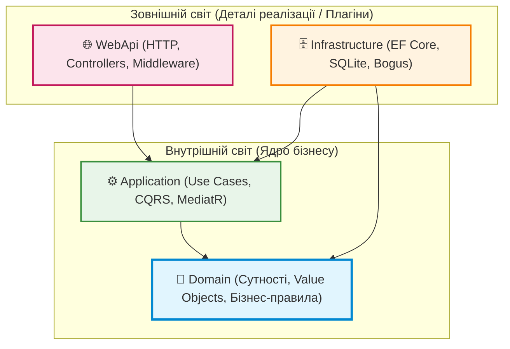
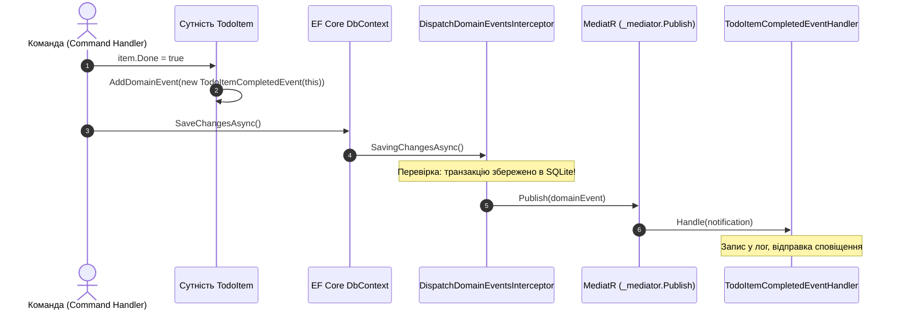
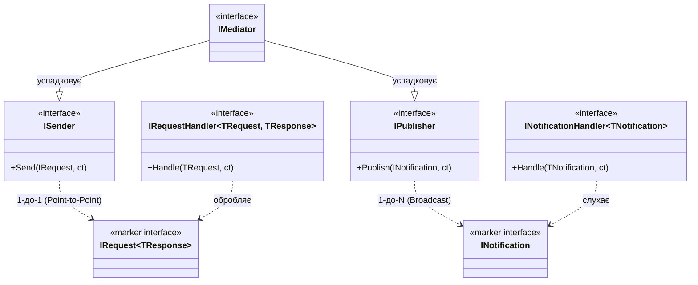

# 🎓 Архітектурний майстер-клас: Clean Architecture, DDD, CQRS, MediatR та Result Pattern

> **Навчальний інтерактивний посібник-презентація на платформі .NET 10**  
> Кожен розділ-слайд починається з **фундаментальної теоретичної преамбули** (що це таке простими словами, аналогія з реального життя, яку конкретну біду у коді це вирішує), після чого подається архітектурна концепція, наочна схема, детальний розбір живого коду з репозиторію та прямі посилання на файли проекту.

---

<a id="toc"></a>
## 📑 Зміст майстер-класу

> *Клікніть на будь-який пункт, щоб миттєво перейти до відповідного слайду:*

1. [Слайд 1. Що таке Clean Architecture і навіщо вона потрібна](#slide-1)
2. [Слайд 2. Еволюція архітектури: чому помер класичний 3-Tier](#slide-2)
3. [Слайд 3. Правило Залежностей: База даних — це всього лише плагін](#slide-3)
4. [Слайд 4. Анатомія 4-х шарів: Domain, Application, Infrastructure, WebApi](#slide-4)
5. [Слайд 5. Слой Domain: Багата модель (Rich) проти Анемічного смітника (Anemic)](#slide-5)
6. [Слайд 6. Value Objects (Об'єкти-значення): Що це таке і чому примітиви вбивають код](#slide-6)
7. [Слайд 7. Value Objects на практиці: Рівність за значенням (ValueObject.cs)](#slide-7)
8. [Слайд 8. Value Objects на практиці: Захист бізнес-правил (Colour.cs, Address.cs)](#slide-8)
9. [Слайд 9. Value Objects у БД: Fluent API (HasConversion проти OwnsOne)](#slide-9)
10. [Слайд 10. Доменні сутності та Корені Агрегатів: Де закінчується відповідальність моделі](#slide-10)
11. [Слайд 11. Доменні події (Domain Events): Відкладена публікація (Two-Phase Dispatch)](#slide-11)
12. [Слайд 12. Патерн CQRS: Чому одна модель для всього — це глухий кут](#slide-12)
13. [Слайд 13. CQRS на практиці: Запити (Queries) — реактивне читання через AsNoTracking](#slide-13)
14. [Слайд 14. CQRS на практиці: Команди (Commands) — непорушність транзакцій](#slide-14)
15. [Слайд 15. Патерн Медіатор: Чому контролери не повинні бути диспетчерами](#slide-15)
16. [Слайд 16. Анатомія MediatR: Розбір інтерфейсів ISender, IPublisher, IRequest](#slide-16)
17. [Слайд 17. Pipeline Behaviors: Конвеєр як рамка металодетектора в аеропорту](#slide-17)
18. [Слайд 18. Централізована валідація: FluentValidation та механізм Short-Circuiting](#slide-18)
19. [Слайд 19. Сквозні аспекти: Логи та замір часу (PerformanceBehavior)](#slide-19)
20. [Слайд 20. Обробка помилок: Чому кидати Exception на кожен чих — це антипатерн](#slide-20)
21. [Слайд 21. Result Pattern у деталях: Чесні контракти методів без аварій](#slide-21)
22. [Слайд 22. Result Pattern у WebApi: Автоматичний мапінг у RFC 7807 ProblemDetails](#slide-22)
23. [Слайд 23. Сидинг даних: Чому хардкод "Test 1" вбиває тестування і навіщо Bogus](#slide-23)
24. [Слайд 24. Архітектурний спір: IApplicationDbContext проти Generic Repository](#slide-24)
25. [Слайд 25. Архітектурні стилі: Clean Architecture проти Vertical Slice Architecture](#slide-25)
26. [Слайд 26. Підсумкова шпаргалка архітектора: Чек-лист проектування](#slide-26)

---

<a id="slide-1"></a>
## Слайд 1. Що таке Clean Architecture і навіщо вона потрібна

### 💡 Теоретична преамбула: Що це фактично таке?
Уявіть собі сучасний автомобіль: двигун, кермо та гальма спроектовані так, що ви можете поставити на нього шини від Michelin, Goodyear або Pirelli. Якщо ви міняєте зимові шини на літні, вам **не потрібно перебирати коробку передач або міняти мотор**. Шини — це змінна деталь.  

**Clean Architecture (Чиста Архітектура)** — це такий самий підхід до проектування софту. Вона стверджує:
> **Ваш бізнес (домен) — це двигун автомобіля. А база даних (SQL Server/SQLite), веб-інтерфейс (ASP.NET/Controllers), відправка пошти чи хмарні сервіси — це всього лише знімні «колеса».**

### 💥 Яку конкретну біль вирішує?
У 90% початкових проектів розробники спочатку створюють таблиці в базі даних, потім генерують сутності ORM, а зверху натягують контролери.  
- **Катастрофа:** Бізнес-логіка виявляється намертво зацементованою у формат SQL-таблиць.
- Якщо керівництво скаже: *«Переходимо з MSSQL на PostgreSQL»* або *«Тепер ці дані приходять не з бази, а через gRPC»*, проект доводиться переписувати з нуля.
- Модульні тести написати неможливо, тому що кожен сервіс вимагає реального підключення до бази даних.

[⬆ До змісту](#toc) • [Наступний слайд ➡](#slide-2)

---

<a id="slide-2"></a>
## Слайд 2. Еволюція архітектури: чому помер класичний 3-Tier

### 💡 Теоретична преамбула: Де ми помилялися раніше?
Класична тришарова архітектура (3-Tier), якої вчили роками:
```
[ Presentation (UI) ] ➡️ [ Business Logic (BLL) ] ➡️ [ Data Access (DAL) ] ➡️ [ База даних ]
```
Зверніть увагу на стрілку: `BLL ➡️ DAL`. Це означає, що **бізнес-логіка прямо залежить від коду доступу до бази**.

### 💥 Чому це виявилося пасткою?
1. **База даних диктує умови домену:** Сутності моделюються так, як зручно реляційним зовнішнім ключам (Foreign Keys), а не так, як мислить бізнес.
2. **Транзитивна залежність:** Якщо DAL тягне бібліотеку `Microsoft.Data.SqlClient`, вся ваша бізнес-логіка стає залежною від конкретного драйвера бази даних.

### 🟢 Вихід: Інверсія залежностей (DIP)
У Clean Architecture шар бізнес-логіки каже базі даних:  
*«Мені байдуже, де і як ти це зберігаєш. Я оголошую інтерфейс `IApplicationDbContext`. Якщо ти, шановна Інфраструктуро, хочеш із нами працювати — реалізуй цей інтерфейс, або ми тебе замінимо»*.

[⬅ Попередній слайд](#slide-1) • [⬆ До змісту](#toc) • [Наступний слайд ➡](#slide-3)

---

<a id="slide-3"></a>
## Слайд 3. Правило Залежностей: База даних — це всього лише плагін

### 💡 Теоретична преамбула: Правило стрілок
У Чистій Архітектурі існує лише одне священне правило:
> **Стрілки залежностей між проектами повинні бути спрямовані СТРОГО ВСЕРЕДИНУ.**  
> Внутрішні шари НІЧОГО не знають про існування зовнішніх шарів.



### 🔍 Перевірка у нашому репозиторії:
Подивіться на файли проектів:
- 👉 [src/Domain/Domain.csproj](../src/Domain/Domain.csproj) — **0 залежностей від решти проектів**. Він навіть не знає, що колись буде запущений у вебі чи збережений у SQLite!
- 👉 [src/Application/Application.csproj](../src/Application/Application.csproj) — знає лише про `Domain`.
- 👉 [src/Infrastructure/Infrastructure.csproj](../src/Infrastructure/Infrastructure.csproj) — знає про `Application` і реалізує його інтерфейси.

[⬅ Попередній слайд](#slide-2) • [⬆ До змісту](#toc) • [Наступний слайд ➡](#slide-4)

---

<a id="slide-4"></a>
## Слайд 4. Анатомія 4-х шарів: Domain, Application, Infrastructure, WebApi

| Шар | Аналогія | Головна роль | Посилання на вихідний код у проекті |
| :--- | :--- | :--- | :--- |
| **`Domain`** | **Закони математики та фізики** | Суть бізнесу, правила, які не залежать від комп'ютера | 👉 [`ValueObject.cs`](../src/Domain/Common/ValueObject.cs) *(рядки 16–60)*<br/>👉 [`Colour.cs`](../src/Domain/ValueObjects/Colour.cs) *(рядки 17–61)*<br/>👉 [`TodoList.cs`](../src/Domain/Entities/TodoList.cs) *(рядки 16–39)* |
| **`Application`** | **Диспетчер завдань / Інструкції** | Сценарії використання системи (Створити список, валідувати команду) | 👉 [`CreateTodoListCommand.cs`](../src/Application/TodoLists/Commands/CreateTodoList/CreateTodoListCommand.cs)<br/>👉 [`ValidationBehavior.cs`](../src/Application/Common/Behaviors/ValidationBehavior.cs) *(рядки 31–73)*<br/>👉 [`Result.cs`](../src/Application/Common/Models/Result.cs) *(рядки 80–125)* |
| **`Infrastructure`** | **Сантехніка та проводи** | Зв'язок із залізом: диск, база даних SQLite, генератори тестових даних | 👉 [`ApplicationDbContext.cs`](../src/Infrastructure/Data/ApplicationDbContext.cs)<br/>👉 [`TodoListConfiguration.cs`](../src/Infrastructure/Data/Configurations/TodoListConfiguration.cs) *(рядки 25–62)*<br/>👉 [`ApplicationDbContextInitialiser.cs`](../src/Infrastructure/Data/Seeding/ApplicationDbContextInitialiser.cs) *(рядки 70–140)* |
| **`WebApi`** | **Вітрина магазину / Ресепшн** | Прийом HTTP-запитів, формування відповідей клієнту, OpenAPI / Scalar UI | 👉 [`ApiControllerBase.cs`](../src/WebApi/Controllers/ApiControllerBase.cs) *(рядки 40–75)*<br/>👉 [`TodoListsController.cs`](../src/WebApi/Controllers/TodoListsController.cs) |

[⬅ Попередній слайд](#slide-3) • [⬆ До змісту](#toc) • [Наступний слайд ➡](#slide-5)

---

<a id="slide-5"></a>
## Слайд 5. Слой Domain: Багата модель (Rich) проти Анемічного смітника (Anemic)

### 💡 Теоретична преамбула: У чому різниця?
- **Анемічна модель (Anemic):** Сутність — це просто структура з `get; set;`. Будь-який зовнішній код може залізти в її нутрощі і перевести її в невалідний стан.
- **Багата модель (Rich Domain Model):** Сутність — це живий об'єкт, який **сам відповідає за свою цілісність**, як клітина живого організму. Стан можна змінити лише через спеціальні бізнес-методи.

### 🔍 Код із нашого проекту:
👉 **[src/Domain/Entities/TodoItem.cs](../src/Domain/Entities/TodoItem.cs)** 📍 *(дивіться рядки 48–75)*

```csharp
public class TodoItem : BaseAuditableEntity
{
    private bool _done;

    // Стан захищений! Не можна просто так "хакнути" прапорець Done:
    public bool Done
    {
        get => _done;
        set
        {
            // Бізнес-правило: якщо завдання переходить у статус Done вперше,
            // сутність сама реєструє доменну подію для інших частин системи!
            if (value && !_done)
            {
                AddDomainEvent(new TodoItemCompletedEvent(this));
            }
            _done = value;
        }
    }

    public void MarkComplete()
    {
        Done = true;
    }
}
```

[⬅ Попередній слайд](#slide-4) • [⬆ До змісту](#toc) • [Наступний слайд ➡](#slide-6)

---

<a id="slide-6"></a>
## Слайд 6. Value Objects (Об'єкти-значення): Що це таке і чому примітиви вбивають код

### 💡 Теоретична преамбула: Аналогія з реального життя «на пальцях»
Уявіть купюру 500 гривень. Якщо ви позичили другу 500 грн купюрою з номером `АА 1234567`, а він через тиждень повернув вам **іншу** купюру з номером `ВВ 7654321` — ви будете задоволені? **Так!**  
Чому? Тому що для вас не має значення конкретний фізичний папірець. Має значення **цінність** (500 грн). Це — **Value Object (Об'єкт-значення)**.  

А тепер уявіть паспорт громадянина. Якщо ви віддали на кордоні свій паспорт, а вам повертають чужий паспорт іншої людини зі словами: *«Ну яка різниця, це ж теж паспорт!»* — ви обуритеся. Паспорт має унікальну **ідентичність (Id)**. Це — **Entity (Сутність)**.

### 💥 Яку катастрофу це вирішує в коді (Primitive Obsession)?
Що робить розробник без Value Object:
```csharp
// ПОГАНО: Primitive Obsession
public void CreateList(string title, string colour, string street, string city)
```
1. Ви можете переплутати аргументи місцями: передати `city` замість `street`. Компілятор не писне, а в базі збережеться каша.
2. У `colour` можна передати `"блакитний"`, `"#123"`, `"трава"` або порожній рядок.
3. Валідацію доведеться писати на кожному кроці знову і знову.

[⬅ Попередній слайд](#slide-5) • [⬆ До змісту](#toc) • [Наступний слайд ➡](#slide-7)

---

<a id="slide-7"></a>
## Слайд 7. Value Objects на практиці: Рівність за значенням (ValueObject.cs)

### 💡 Теоретична преамбула: Як комп'ютер розуміє, що два об'єкти однакові?
За замовчуванням у C# два класи порівнюються за **посиланням у пам'яті (Reference Equality)**. Тобто:
```csharp
var c1 = new Colour("#FFFFFF");
var c2 = new Colour("#FFFFFF");
c1 == c2 // FALSE! Вони в різних комірках оперативної пам'яті!
```
Для Value Object це неприпустимо: два кольори `#FFFFFF` зобов'язані бути **абсолютно рівними**!

### 🔍 Код із нашого проекту:
👉 **[src/Domain/Common/ValueObject.cs](../src/Domain/Common/ValueObject.cs)** 📍 *(дивіться рядки 16–60)*

```csharp
public abstract class ValueObject : IEquatable<ValueObject>
{
    // Кожен конкретний об'єкт перераховує поля, які визначають його сутність
    protected abstract IEnumerable<object?> GetEqualityComponents();

    public override bool Equals(object? obj)
    {
        if (obj is null || obj.GetType() != GetType()) return false;
        var other = (ValueObject)obj;
        // Порівнюємо значення всіх полів по черзі!
        return GetEqualityComponents().SequenceEqual(other.GetEqualityComponents());
    }

    public static bool operator ==(ValueObject? a, ValueObject? b) => a?.Equals(b) ?? b is null;
    public static bool operator !=(ValueObject? a, ValueObject? b) => !(a == b);
}
```

[⬅ Попередній слайд](#slide-6) • [⬆ До змісту](#toc) • [Наступний слайд ➡](#slide-8)

---

<a id="slide-8"></a>
## Слайд 8. Value Objects на практиці: Захист бізнес-правил (Colour.cs, Address.cs)

### 💡 Теоретична преамбула: Принцип неможливості невалідного стану
Value Object проектується так, що його **фізично неможливо створити у зламаному стані**.

### 🔍 Код із нашого проекту:
👉 **[src/Domain/ValueObjects/Colour.cs](../src/Domain/ValueObjects/Colour.cs)** 📍 *(дивіться рядки 22–61)*

```csharp
public class Colour : ValueObject
{
    // 1. Приватний конструктор: забороняє створити пустий або непроперевірений колір
    private Colour(string code) => Code = code;

    // 2. Фабричний метод: гарантує валідність інваріанта
    public static Colour From(string code)
    {
        var colour = new Colour(code);
        if (!SupportedColours.Contains(colour))
            throw new UnsupportedColourException(code);

        return colour;
    }

    public static Colour White => new("#FFFFFF");
    public static Colour Red   => new("#FF5733");
    public static Colour Blue  => new("#6666FF");

    public string Code { get; private set; } = "#FFFFFF";

    protected override IEnumerable<object?> GetEqualityComponents()
    {
        yield return Code; // Для рівності кольорів порівнюємо їхній Hex-код
    }
}
```
*Комплексний приклад із багатьма полями (Street, City, ZipCode):*  
👉 **[src/Domain/ValueObjects/Address.cs](../src/Domain/ValueObjects/Address.cs)** 📍 *(дивіться рядки 17–53)*

[⬅ Попередній слайд](#slide-7) • [⬆ До змісту](#toc) • [Наступний слайд ➡](#slide-9)

---

<a id="slide-9"></a>
## Слайд 9. Value Objects у БД: Fluent API (HasConversion проти OwnsOne)

### 💡 Теоретична преамбула: Як реляційна база сприймає об'єкти без Id?
У реляційній СУБД (SQL) кожна таблиця хоче мати Primary Key. Але у Value Object немає Id!  
Як Entity Framework Core зберігає такі класи:
1. **HasConversion (для одинарних значень):** Об'єкт `Colour` перетворюється на звичайну колонку `TEXT` або `VARCHAR(10)` у таблиці списків.
2. **OwnsOne (для комплексних значень):** Всі поля `Address` (вулиця, місто, індекс) розгортаються у колонки `Location_Street`, `Location_City` тієї ж самої таблиці `TodoLists` без створення зайвих зв'язків і таблиць!

### 🔍 Код із нашого проекту:
👉 **[src/Infrastructure/Data/Configurations/TodoListConfiguration.cs](../src/Infrastructure/Data/Configurations/TodoListConfiguration.cs)** 📍 *(дивіться рядки 37–55)*

```csharp
// 1. Конвертер значень для Colour (підхід Jason Taylor)
builder.Property(t => t.Colour)
    .HasConversion(
        colour => colour.Code,         // Як записати в БД
        code => Colour.From(code))     // Як відновити об'єкт із БД
    .HasMaxLength(10);

// 2. Вбудований об'єкт OwnsOne для адреси
builder.OwnsOne(b => b.Location, ab =>
{
    ab.Property(a => a.Street).HasColumnName("Location_Street").HasMaxLength(150);
    ab.Property(a => a.City).HasColumnName("Location_City").HasMaxLength(100);
});
```

[⬅ Попередній слайд](#slide-8) • [⬆ До змісту](#toc) • [Наступний слайд ➡](#slide-10)

---

<a id="slide-10"></a>
## Слайд 10. Доменні сутності та Корені Агрегатів: Де закінчується відповідальність моделі

### 💡 Теоретична преамбула: Межа узгодженості (Consistency Boundary)
Уявіть замовлення в інтернет-магазині (`Order`) та позиції в ньому (`OrderItem`).  
Чи має право зовнішній сервіс видалити позицію з замовлення так, щоб загальна сума замовлення не перерахувалася? **Ніколи!**  
Тому `Order` є **Коренем Агрегату (Aggregate Root)**. Будь-які зміни з його дочірніми елементами зобов'язані проходити виключно через нього.

У нашому проекті:
- 👉 [TodoList.cs](../src/Domain/Entities/TodoList.cs) *(рядки 16–39)* — корінь агрегату, що володіє колекцією `Items`.
- 👉 [TodoItem.cs](../src/Domain/Entities/TodoItem.cs) *(рядки 16–75)* — сутність всередині агрегату.

[⬅ Попередній слайд](#slide-9) • [⬆ До змісту](#toc) • [Наступний слайд ➡](#slide-11)

---

<a id="slide-11"></a>
## Слайд 11. Доменні події (Domain Events): Відкладена публікація (Two-Phase Dispatch)

### 💡 Теоретична преамбула: Чому не можна одразу слати Email?
Коли завдання позначається як виконане (`Done = true`), ми хочемо надіслати сповіщення.  
- **Якщо викликати `EmailService` одразу в сутності:** Сутність забруднюється мережевими залежностями.
- **Найстрашніше:** Якщо після відправки Email відвалиться база даних, транзакція відкотиться назад, завдання залишиться невиконаним, але користувач **вже отримає листа** про те, що воно виконано!

### 🟢 Рішення: Двофазна публікація (Two-Phase Dispatching)
1. **Фаза 1 (у пам'яті):** Сутність додає подію до свого внутрішнього списку `DomainEvents`.
2. **Фаза 2 (при збереженні):** Інтерцептор EF Core чекає, поки база даних зафіксує транзакцію. Лише після цього події розсилаються підписникам!



👉 **[src/Infrastructure/Data/Interceptors/DispatchDomainEventsInterceptor.cs](../src/Infrastructure/Data/Interceptors/DispatchDomainEventsInterceptor.cs)** 📍 *(дивіться рядки 40–79)*

[⬅ Попередній слайд](#slide-10) • [⬆ До змісту](#toc) • [Наступний слайд ➡](#slide-12)

---

<a id="slide-12"></a>
## Слайд 12. Патерн CQRS: Чому одна модель для всього — це глухий кут

### 💡 Теоретична преамбула: Автомобіль чи вантажівка?
Уявіть, що ви намагаєтеся побудувати автомобіль, який одночасно повинен бути болідом Формули-1 (надшвидким) і самоскидом (перевозити 10 тонн піску). Вийде жахлива, повільна і дорога потвора.  

У програмуванні:
- **Запис (Мутація):** Це самоскид. Потрібна обережність, транзакції, перевірка бізнес-правил, захист інваріантів.
- **Читання (Вибірка):** Це болід. Потрібно максимально швидко висмикнути 10 колонок з бази і віддати на фронтенд.

**CQRS (Command Query Responsibility Segregation)** стверджує:
> **Розділіть модель читання (Queries) і модель запису (Commands). Не намагайтеся натягнути одну доменну сутність на обидві ці задачі.**

[⬅ Попередній слайд](#slide-11) • [⬆ До змісту](#toc) • [Наступний слайд ➡](#slide-13)

---

<a id="slide-13"></a>
## Слайд 13. CQRS на практиці: Запити (Queries) — реактивне читання через AsNoTracking

### 🔍 Код із нашого проекту:
👉 **[src/Application/TodoLists/Queries/GetTodoLists/GetTodoListsQueryHandler.cs](../src/Application/TodoLists/Queries/GetTodoLists/GetTodoListsQueryHandler.cs)** 📍 *(дивіться рядки 38–58)*

```csharp
public async Task<TodoListsVm> Handle(GetTodoListsQuery request, CancellationToken ct)
{
    var lists = await _context.TodoLists
        .AsNoTracking() // ⚡ КРОК 1: Вимикаємо відстеження змін у ChangeTracker (економія пам'яті!)
        .OrderBy(t => t.Title)
        .Select(t => new TodoListDto // ⚡ КРОК 2: Проекція в SQL: EF Core формує запит лише на потрібні поля
        {
            Id = t.Id,
            Title = t.Title,
            Colour = t.Colour.Code,
            Location = t.Location != null ? t.Location.ToString() : null,
            Items = t.Items.Select(i => new TodoItemDto { ... }).ToList()
        })
        .ToListAsync(ct);

    return new TodoListsVm { Lists = lists };
}
```
*У цьому методі сутності Domain навіть не завантажуються в пам'ять як Entity! Вони одразу транслюються в плоский DTO.*

[⬅ Попередній слайд](#slide-12) • [⬆ До змісту](#toc) • [Наступний слайд ➡](#slide-14)

---

<a id="slide-14"></a>
## Слайд 14. CQRS на практиці: Команди (Commands) — непорушність транзакцій

### 🔍 Код із нашого проекту:
👉 **[src/Application/TodoLists/Commands/CreateTodoList/CreateTodoListCommandHandler.cs](../src/Application/TodoLists/Commands/CreateTodoList/CreateTodoListCommandHandler.cs)** 📍 *(дивіться рядки 44–68)*

```csharp
public async Task<int> Handle(CreateTodoListCommand request, CancellationToken ct)
{
    // 1. Створюємо справжню доменну сутність
    var entity = new TodoList { Title = request.Title };

    // 2. Викликаємо валідацію доменного інваріанта через Value Object
    if (!string.IsNullOrWhiteSpace(request.Colour))
        entity.Colour = Colour.From(request.Colour);

    _context.TodoLists.Add(entity);

    // 3. Зберігаємо зміни у базі. Interceptors автоматично заповнять CreatedAtUtc
    await _context.SaveChangesAsync(ct);

    return entity.Id;
}
```

[⬅ Попередній слайд](#slide-13) • [⬆ До змісту](#toc) • [Наступний слайд ➡](#slide-15)

---

<a id="slide-15"></a>
## Слайд 15. Патерн Медіатор: Чому контролери не повинні бути диспетчерами

### 💡 Теоретична преамбула: Авіадиспетчер в аеропорту
Уявіть аеропорт, де сідають 50 літаків. Якщо кожен пілот намагатиметься напряму по рації зв'язатися з усіма іншими 49 пілотами, щоб дізнатися, хто перший займе злітну смугу — відбудеться катастрофа.  
Тому є **вежа авіадиспетчера (Mediator)**. Пілот говорить тільки з диспетчером: *«Я готовий сідати»*. Диспетчер сам знає, кому і яку смугу виділити.  

У вебі: контролер — це пілот. Йому не треба знати про 10 різних сервісів. Він звертається до диспетчера: `_sender.Send(command)`.

[⬅ Попередній слайд](#slide-14) • [⬆ До змісту](#toc) • [Наступний слайд ➡](#slide-16)

---

<a id="slide-16"></a>
## Слайд 16. Анатомія MediatR: Розбір інтерфейсів ISender, IPublisher, IRequest

> 📖 **Детальний довідник:** Повний розбір методів та інтерфейсів дивіться у [docs/MediatR-Guide.md](MediatR-Guide.md#toc).



### 📋 Чому контролер використовує саме `ISender`?
👉 **[src/WebApi/Controllers/ApiControllerBase.cs](../src/WebApi/Controllers/ApiControllerBase.cs)** 📍 *(дивіться рядки 49–50)*

```csharp
protected ISender Mediator => _mediator ??= HttpContext.RequestServices.GetRequiredService<ISender>();
```
Це принцип розділення інтерфейсів (**ISP**): контролеру ніколи не потрібен метод `Publish()` для розсилки доменних подій. Йому потрібен лише метод `Send()`.

[⬅ Попередній слайд](#slide-15) • [⬆ До змісту](#toc) • [Наступний слайд ➡](#slide-17)

---

<a id="slide-17"></a>
## Слайд 17. Pipeline Behaviors: Конвеєр як рамка металодетектора в аеропорту

### 💡 Теоретична преамбула: Як влаштований конвеєр?
Перед тим як сісти в літак, пасажир проходить:
1. Перевірку квитка (Logging);
2. Рамку металодетектора та багажу (Validation);
3. Паспортний контроль (Authentication/Authorization).  
Якщо у валізі знайдено заборонені речі, **вас не пускають далі**. До літака (до бізнес-хендлера) ви навіть не доходите!  

У MediatR це реалізується через **`IPipelineBehavior<TRequest, TResponse>`**.

```
HTTP Запит
   ⬇
[ LoggingBehavior ]     -> Фіксує: хто і з чим зайшов
   ⬇
[ ValidationBehavior ]  -> Перевіряє правила FluentValidation
   ⬇ (якщо дані криві -> зупиняє запит і кидає 400 Bad Request)
[ PerformanceBehavior ] -> Засікає час виконання таймером
   ⬇
[ IRequestHandler ]     -> Виконує чисту бізнес-логіку
```

👉 **[Реєстрація конвеєра в DI: src/Application/DependencyInjection.cs](../src/Application/DependencyInjection.cs)** 📍 *(дивіться рядки 48–69)*

[⬅ Попередній слайд](#slide-16) • [⬆ До змісту](#toc) • [Наступний слайд ➡](#slide-18)

---

<a id="slide-18"></a>
## Слайд 18. Централізована валідація: FluentValidation та механізм Short-Circuiting

### 🔍 Код із нашого проекту:
👉 **[src/Application/Common/Behaviors/ValidationBehavior.cs](../src/Application/Common/Behaviors/ValidationBehavior.cs)** 📍 *(дивіться рядки 44–73)*

```csharp
public async Task<TResponse> Handle(TRequest request, RequestHandlerDelegate<TResponse> next, CancellationToken ct)
{
    if (_validators.Any())
    {
        var context = new ValidationContext<TRequest>(request);
        var validationResults = await Task.WhenAll(_validators.Select(v => v.ValidateAsync(context, ct)));
        var failures = validationResults.SelectMany(r => r.Errors).Where(f => f != null).ToList();

        // МЕХАНІЗМ SHORT-CIRCUITING:
        // Якщо хоча б одне поле невалідне - викидаємо ValidationException.
        // Зверніть увагу: метод next() НЕ викликається! Хендлер не запуститься!
        if (failures.Count != 0)
            throw new ValidationException(failures);
    }

    return await next(); // Передаємо керування наступному кроку конвеєра
}
```

[⬅ Попередній слайд](#slide-17) • [⬆ До змісту](#toc) • [Наступний слайд ➡](#slide-19)

---

<a id="slide-19"></a>
## Слайд 19. Сквозні аспекти: Логи та замір часу (PerformanceBehavior)

### 🔍 Код із нашого проекту:
👉 **[src/Application/Common/Behaviors/PerformanceBehavior.cs](../src/Application/Common/Behaviors/PerformanceBehavior.cs)** 📍 *(дивіться рядки 27–50)*

```csharp
public async Task<TResponse> Handle(TRequest request, RequestHandlerDelegate<TResponse> next, CancellationToken ct)
{
    _timer.Start();

    var response = await next(); // Виконується хендлер

    _timer.Stop();

    // Автоматичний захист: якщо будь-яка команда чи запит виконується довше 500 мс,
    // система автоматично реєструє попередження у журналах!
    if (_timer.ElapsedMilliseconds > 500)
    {
        _logger.LogWarning("Повільний запит! {RequestName} ({ElapsedMilliseconds} мс)",
            typeof(TRequest).Name, _timer.ElapsedMilliseconds);
    }

    return response;
}
```

[⬅ Попередній слайд](#slide-18) • [⬆ До змісту](#toc) • [Наступний слайд ➡](#slide-20)

---

<a id="slide-20"></a>
## Слайд 20. Обробка помилок: Чому кидати Exception на кожен чих — це антипатерн

### 💡 Теоретична преамбула: Аварія проти штатного сценарію
Уявіть, що ви зайшли в магазин і запитали у продавця: *«Чи є у вас сік манго?»*.  
- **Нормальний продавець відповість:** *«Ні, на жаль, закінчився»* (Це — Result Pattern).
- **Продавець-психопат:** Вмикає пожежну тривогу, стрибає у вікно та викликає поліцію (Це — кидання `throw new NotFoundException()`).

### 💥 Чому `throw Exception` для бізнес-помилок — це жахливо?
1. **Швидкодія:** Генерація винятку в .NET змушує рантайм зупиняти потік і збирати повний стек викликів (Stack Trace). Це у **100–1000 разів повільніше**, ніж повернення звичайного значення!
2. **Нечесні контракти:** Метод `Task<TodoItemDto> GetById(int id)` приховує від вас факт того, що він може впасти з помилкою.

[⬅ Попередній слайд](#slide-19) • [⬆ До змісту](#toc) • [Наступний слайд ➡](#slide-21)

---

<a id="slide-21"></a>
## Слайд 21. Result Pattern у деталях: Чесні контракти методів без аварій

### 🔍 Код моделей:
👉 **[src/Application/Common/Models/Result.cs](../src/Application/Common/Models/Result.cs)** 📍 *(дивіться рядки 80–125)*

```csharp
public class Result<TValue>
{
    public bool IsSuccess { get; }
    public bool IsFailure => !IsSuccess;
    public TValue? Value { get; }
    public Error Error { get; }

    public static Result<TValue> Success(TValue value) => new(value);
    public static Result<TValue> Failure(Error error) => new(error);

    // Неявне приведення типів дозволяє лаконічно повертати значення або помилку
    public static implicit operator Result<TValue>(TValue value) => Success(value);
    public static implicit operator Result<TValue>(Error error) => Failure(error);
}
```

### 🔍 Використання у Query:
👉 **[src/Application/TodoItems/Queries/GetTodoItemById/GetTodoItemByIdQuery.cs](../src/Application/TodoItems/Queries/GetTodoItemById/GetTodoItemByIdQuery.cs)** 📍 *(дивіться рядки 31–52)*

```csharp
public async Task<Result<TodoItemBriefDto>> Handle(GetTodoItemByIdQuery request, CancellationToken ct)
{
    var item = await _context.TodoItems.FindAsync(new object[] { request.Id }, ct);

    if (item is null)
    {
        // Повертаємо об'єкт помилки без жодного throw!
        return Error.NotFound("TodoItem.NotFound", $"Завдання з Id {request.Id} не знайдено.");
    }

    return Result<TodoItemBriefDto>.Success(new TodoItemBriefDto { ... });
}
```

[⬅ Попередній слайд](#slide-20) • [⬆ До змісту](#toc) • [Наступний слайд ➡](#slide-22)

---

<a id="slide-22"></a>
## Слайд 22. Result Pattern у WebApi: Автоматичний мапінг у RFC 7807 ProblemDetails

### 🔍 Код контролера:
👉 **[src/WebApi/Controllers/ApiControllerBase.cs](../src/WebApi/Controllers/ApiControllerBase.cs)** 📍 *(дивіться рядки 54–111)*

```csharp
protected ActionResult HandleResult<T>(Result<T> result)
{
    if (result.IsSuccess) 
        return result.Value is not null ? Ok(result.Value) : NoContent();

    // Автоматичне перетворення типу помилки у міжнародний стандарт ProblemDetails:
    return result.Error.Type switch
    {
        ErrorType.NotFound   => Problem(statusCode: 404, title: "Ресурс не знайдено", detail: result.Error.Description),
        ErrorType.Validation => Problem(statusCode: 400, title: "Помилка валідації",  detail: result.Error.Description),
        ErrorType.Conflict   => Problem(statusCode: 409, title: "Конфлікт стану",     detail: result.Error.Description),
        _                    => Problem(statusCode: 500, detail: result.Error.Description)
    };
}
```

[⬅ Попередній слайд](#slide-21) • [⬆ До змісту](#toc) • [Наступний слайд ➡](#slide-23)

---

<a id="slide-23"></a>
## Слайд 23. Сидинг даних: Чому хардкод "Test 1" вбиває тестування і навіщо Bogus

### 💡 Теоретична преамбула: Чому реалістичні дані критично важливі?
Якщо наповнити базу записами типу `Title: "1"`, `Note: "1"`, розробник ніколи не помітить, що:
- Довгий заголовок ламає верстку на фронтенді;
- Пошук за українськими літерами («І», «Ї», «Є») працює некоректно через Collation;
- Форматування адреси виглядає безглуздо.

Бібліотека **Bogus** генерує реальні україномовні тексти, назви завдань та адреси, а детерміноване зерно (`Randomizer.Seed = new Random(42)`) гарантує, що при кожному запуску база міститиме абсолютно однаковий тестовий набір.  

👉 **[src/Infrastructure/Data/Seeding/ApplicationDbContextInitialiser.cs](../src/Infrastructure/Data/Seeding/ApplicationDbContextInitialiser.cs)** 📍 *(дивіться рядки 70–140)*

[⬅ Попередній слайд](#slide-22) • [⬆ До змісту](#toc) • [Наступний слайд ➡](#slide-24)

---

<a id="slide-24"></a>
## Слайд 24. Архітектурний спір: IApplicationDbContext проти Generic Repository

### 💡 Теоретична преамбула: Навіщо будувати репозиторій поверх репозиторію?
Паттерн Репозиторій був придуманий у часи, коли розробники вручну писали SQL-запити через `SqlCommand` та `SqlDataReader`.  
Але в сучасному .NET:
- **`DbContext` вже є Unit of Work.**
- **`DbSet<T>` вже є Репозиторієм.**

Створення класу `GenericRepository<T>` поверх EF Core найчастіше лише калічить можливості LINQ, змушуючи розробників вигадувати монструозні конструкції на кшталт `repository.Get(x => x.Id == 1, includes: "Items,Location")`.  
Шаблон Jason Taylor вирішує це елегантно: шар `Application` оголошує інтерфейс `IApplicationDbContext`, що надає доступ до `DbSet<T>`, зберігаючи повну міць LINQ і залишаючись тестованим.  

👉 **[src/Application/Common/Interfaces/IApplicationDbContext.cs](../src/Application/Common/Interfaces/IApplicationDbContext.cs)**

[⬅ Попередній слайд](#slide-23) • [⬆ До змісту](#toc) • [Наступний слайд ➡](#slide-25)

---

<a id="slide-25"></a>
## Слайд 25. Архітектурні стилі: Clean Architecture проти Vertical Slice Architecture

| Критерій | Clean Architecture | Vertical Slice Architecture (VSA) |
| :--- | :--- | :--- |
| **Принцип поділу** | **Горизонтальний** (шари: Domain, App, Infra, Web) | **Вертикальний** (по фічах: `CreateTodo/`, `GetTodo/`) |
| **Локальність коду** | Код однієї фічі розкладено по 4 різних проектах | Весь код фічі (ендпоінт, валідатор, команда) лежить в одній папці |
| **Складність змін** | Вимагає високої дисципліни архітектури | Кожна фіча незалежна, її можна легко видалити або переписати |
| **Коли обирати** | Великі Enterprise проекти зі спільними доменними правилами | Швидкі мікросервіси, стартапи, модульні моноліти |

[⬅ Попередній слайд](#slide-24) • [⬆ До змісту](#toc) • [Наступний слайд ➡](#slide-26)

---

<a id="slide-26"></a>
## Слайд 26. Підсумкова шпаргалка архітектора: Чек-лист проектування

### 📋 Золоті правила для розробника:
1. **Чистота ядра:** Якщо у проекті `Domain` з'явилася бібліотека для роботи з БД чи вебом — це архітектурна помилка.
2. **Ні примітивам:** Кольори, адреси, гроші та статуси моделюйте як **Value Objects**.
3. **Розділяйте потоки:** Запити на читання (Queries) мають використовувати `AsNoTracking()` і проекцію `.Select()` безпосередньо у DTO.
4. **Валідація окремо від коду:** Не пишіть ручні `if (string.IsNullOrEmpty)` у хендлерах — використовуйте **FluentValidation** у конвеєрі MediatR.
5. **Ні киданню Exception для штатної логіки:** Якщо запис відсутній у базі — повертайте **`Result<T>.Failure(Error.NotFound)`**.

[⬅ Попередній слайд](#slide-25) • [⬆ До змісту](#toc)
