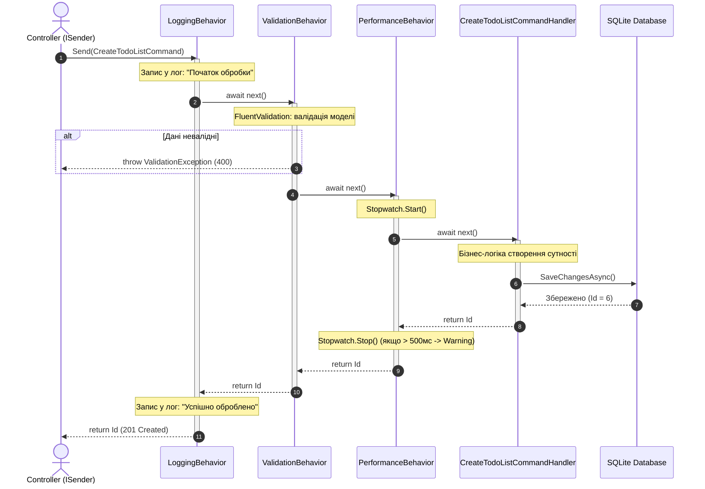

# 📡 Детальний довідник з MediatR у Clean Architecture

> Цей документ створено спеціально для глибокого розуміння того, **що таке кожен інтерфейс та метод у бібліотеці MediatR**, як вони взаємодіють між собою і чому саме так організовано код у проєкті.

---

## 🗺️ Загальна карта інтерфейсів MediatR

```mermaid
graph TD
    subgraph Core Abstractions
        IMediator["IMediator<br/>(Головний інтерфейс)"]
        ISender["ISender<br/>Send() -> Point-to-Point"]
        IPublisher["IPublisher<br/>Publish() -> Pub-Sub"]
        
        IMediator --> ISender
        IMediator --> IPublisher
    end

    subgraph "1. Запити та Команди (Point-to-Point, 1-до-1)"
        IReq["IRequest&lt;TResponse&gt; / IRequest<br/>(Повідомлення команди або запиту)"]
        IReqHandler["IRequestHandler&lt;TRequest, TResponse&gt;<br/>Handle(request, cancellationToken)"]
        IPipeline["IPipelineBehavior&lt;TRequest, TResponse&gt;<br/>Handle(request, next, cancellationToken)"]
        
        ISender -->|Відправляє| IReq
        IReq -->|Перехоплюється| IPipeline
        IPipeline -->|Передає через next()| IReqHandler
    end

    subgraph "2. Події та Сповіщення (Pub-Sub, 1-до-N)"
        INotif["INotification<br/>(Доменна подія / сповіщення)"]
        INotifHandler1["INotificationHandler&lt;TNotification&gt; (Логування)"]
        INotifHandler2["INotificationHandler&lt;TNotification&gt; (Email)"]
        INotifHandlerN["INotificationHandler&lt;TNotification&gt; (...)"]
        
        IPublisher -->|Публікує| INotif
        INotif -->|Викликає одночасно| INotifHandler1
        INotif -->|Викликає одночасно| INotifHandler2
        INotif -->|Викликає одночасно| INotifHandlerN
    end
```

---

## 1. Базові інтерфейси відправки повідомлень

### 🔸 `ISender`
- **Що це**: Інтерфейс для передачі команд або запитів за схемою **"Один до одного" (Request-Response / Point-to-Point)**.
- **Основний метод**:
  ```csharp
  Task<TResponse> Send<TResponse>(IRequest<TResponse> request, CancellationToken cancellationToken = default);
  ```
- **Де використовується**:
  У контролерах WebApi (`ApiControllerBase`):
  ```csharp
  protected ISender Mediator => _mediator ??= HttpContext.RequestServices.GetRequiredService<ISender>();
  ```
- **Чому використовується саме `ISender`, а не `IMediator`?**  
  Принцип розділення інтерфейсів (**ISP - Interface Segregation Principle**). Контролеру потрібно тільки надсилати команди/запити, йому не потрібен метод `Publish()`.

---

### 🔸 `IPublisher`
- **Що це**: Інтерфейс для публікації подій за схемою **"Один до багатьох" (Publish-Subscribe / Broadcast)**.
- **Основний метод**:
  ```csharp
  Task Publish(object notification, CancellationToken cancellationToken = default);
  Task Publish<TNotification>(TNotification notification, CancellationToken cancellationToken = default) 
      where TNotification : INotification;
  ```
- **Де використовується**:
  В інфраструктурних перехоплювачах (`DispatchDomainEventsInterceptor`):
  ```csharp
  foreach (var domainEvent in domainEvents)
  {
      await _mediator.Publish(domainEvent, cancellationToken);
  }
  ```
- **Як працює**:
  Знаходить у DI контейнері **всі** класи, що реалізують `INotificationHandler<TNotification>`, і послідовно або паралельно викликає їхній метод `Handle()`.

---

### 🔸 `IMediator`
- **Що це**: Об'єднуючий інтерфейс, який успадковує як `ISender`, так і `IPublisher`:
  ```csharp
  public interface IMediator : ISender, IPublisher { }
  ```
- Використовується там, де компоненту потрібні обидві можливості одночасно.

---

## 2. Інтерфейси для CQRS (Commands & Queries)

### 🔸 `IRequest<TResponse>` та `IRequest`
- **Що це**: Маркерний інтерфейс (Marker Interface), який позначає клас як повідомлення запиту.
- **Два різновиди**:
  1. `IRequest<TResponse>` — використовується, коли обробник повертає значення (наприклад, ID створеного запису, DTO, список моделей).
     ```csharp
     public record CreateTodoListCommand : IRequest<int>;
     public record GetTodoListsQuery : IRequest<TodoListsVm>;
     ```
  2. `IRequest` (без типу) — використовується, коли команда нічого не повертає (аналог `void`).
     ```csharp
     public record DeleteTodoListCommand(int Id) : IRequest;
     ```
     *(Під капотом MediatR замінює `IRequest` на `IRequest<Unit>`, де `Unit` — спеціальна структура, що позначає порожній результат).*

---

### 🔸 `IRequestHandler<TRequest, TResponse>`
- **Що це**: Головний інтерфейс обробника (Handler) бізнес-логіки для конкретного `TRequest`.
- **Основний метод**:
  ```csharp
  Task<TResponse> Handle(TRequest request, CancellationToken cancellationToken);
  ```
- **Параметри методу `Handle`**:
  - `request` — екземпляр команди/запиту з усіма даними від клієнта.
  - `cancellationToken` — токен відміни операції. Його **обов'язково** потрібно передавати у всі асинхронні виклики (наприклад, `_context.SaveChangesAsync(cancellationToken)`). Якщо клієнт закрив вкладку або обірвався зв'язок, виконання в базі даних буде безпечно перервано.
- **Головне правило**:
  Для одного `IRequest` у системі повинен існувати **РІВНО ОДИН** `IRequestHandler`. Якщо зареєструвати нуль або два — MediatR викине виняток.

---

## 3. Інтерфейси для доменних подій (Domain Events)

### 🔸 `INotification`
- **Що це**: Маркерний інтерфейс для подій та сповіщень.
- **Приклад у нашому коді**:
  ```csharp
  public abstract class BaseEvent : MediatR.INotification
  {
      public DateTime DateOccurredUtc { get; protected set; } = DateTime.UtcNow;
  }
  
  public class TodoItemCompletedEvent : BaseEvent
  {
      public TodoItem Item { get; }
      public TodoItemCompletedEvent(TodoItem item) => Item = item;
  }
  ```
- **Відмінність від `IRequest`**:
  - `IRequest` — це наказ "Зроби дію" (команда, має 1 виконавця).
  - `INotification` — це факт "Щось уже відбулося" (подія, на яку може підписатися будь-яка кількість модулів).

---

### 🔸 `INotificationHandler<TNotification>`
- **Що це**: Інтерфейс підписника на конкретну доменну подію.
- **Основний метод**:
  ```csharp
  Task Handle(TNotification notification, CancellationToken cancellationToken);
  ```
- **Приклад у нашому коді**:
  ```csharp
  public class TodoItemCompletedEventHandler : INotificationHandler<TodoItemCompletedEvent>
  {
      public Task Handle(TodoItemCompletedEvent notification, CancellationToken cancellationToken)
      {
          // Логування, відправка email, оновлення статистики тощо
          return Task.CompletedTask;
      }
  }
  ```
  Можна створити безліч різних класів `INotificationHandler<TodoItemCompletedEvent>`, і MediatR викличе їх усі!

---

## 4. Конвеєри поведінки (Pipeline Behaviors)

### 🔸 `IPipelineBehavior<TRequest, TResponse>`
- **Що це**: Інтерфейс для створення "Middleware для MediatR". Він дозволяє виконувати наскрізну логіку (логування, валідація, кешування, моніторинг) для **всіх** запитів у системі.
- **Основний метод**:
  ```csharp
  Task<TResponse> Handle(
      TRequest request, 
      RequestHandlerDelegate<TResponse> next, 
      CancellationToken cancellationToken);
  ```

### 🔸 `RequestHandlerDelegate<TResponse>`
- **Що це**: Делегат, який представляє наступний крок у конвеєрі:
  ```csharp
  public delegate Task<TResponse> RequestHandlerDelegate<TResponse>();
  ```
- **Як це працює**:
  - Виклик `await next()` передає керування наступному зареєстрованому Behavior або кінцевому `IRequestHandler`.
  - Якщо НЕ викликати `await next()` (як у випадку помилки валідації у `ValidationBehavior`), ланцюжок переривається (**Short-circuiting**), і хендлер навіть не починає виконуватися!



---

## 5. Реєстрація у контейнері Dependency Injection

У файлі `src/Application/DependencyInjection.cs`:
```csharp
services.AddMediatR(cfg =>
{
    // Метод 1: Автоматичне сканування поточної збірки
    // Знаходить і реєструє всі IRequestHandler та INotificationHandler
    cfg.RegisterServicesFromAssembly(Assembly.GetExecutingAssembly());

    // Метод 2: Реєстрація відкритих дженериків (Open Generics) для конвеєрів
    cfg.AddBehavior(typeof(IPipelineBehavior<,>), typeof(LoggingBehavior<,>));
    cfg.AddBehavior(typeof(IPipelineBehavior<,>), typeof(ValidationBehavior<,>));
    cfg.AddBehavior(typeof(IPipelineBehavior<,>), typeof(PerformanceBehavior<,>));
});
```

- **Що таке `typeof(IPipelineBehavior<,>)` з комою всередині?**  
  Це відкритий тип (Open Generic). Завдяки цьому нам не потрібно вручну прописувати `ValidationBehavior<CreateTodoListCommand, int>`, `ValidationBehavior<UpdateTodoListCommand, Unit>` і так далі для кожної команди. MediatR та .NET DI роблять це автоматично "на льоту" для абсолютно всіх команд та запитів!
