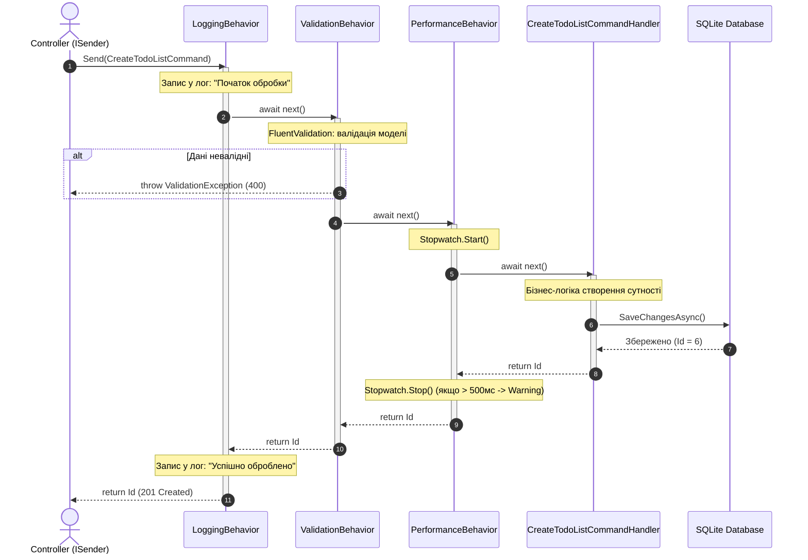

# 📡 Детальний довідник з MediatR у Clean Architecture

> Цей документ створено спеціально для глибокого розуміння того, **що таке кожен інтерфейс та метод у бібліотеці MediatR**, як вони взаємодіють між собою і чому саме так організовано код у проєкті.

---

<a id="toc"></a>
## 📑 Зміст довідника

> *Клікніть на будь-який пункт, щоб перейти до відповідного розділу:*

- [🗺️ Загальна карта інтерфейсів MediatR](#map)
- [1. Базові інтерфейси відправки повідомлень](#part-1)
  - [🔸 ISender — відправка 1-до-1](#isender)
  - [🔸 IPublisher — публікація 1-до-N](#ipublisher)
  - [🔸 IMediator — повний фасад](#mediator)
- [2. Інтерфейси для CQRS (Commands & Queries)](#part-2)
  - [🔸 IRequest&lt;TResponse&gt; та IRequest](#irequest)
  - [🔸 IRequestHandler&lt;TRequest, TResponse&gt;](#irequesthandler)
- [3. Інтерфейси для доменних подій (Domain Events)](#part-3)
  - [🔸 INotification](#inotification)
  - [🔸 INotificationHandler&lt;TNotification&gt;](#inotificationhandler)
- [4. Конвеєри поведінки (Pipeline Behaviors)](#part-4)
  - [🔸 IPipelineBehavior та RequestHandlerDelegate](#pipeline-behaviors)
  - [🔸 Схема проходження запиту крізь конвеєр](#pipeline-flow)
- [5. Реєстрація у контейнері Dependency Injection (Open Generics)](#part-5)
- [📊 Повернутися до презентації (Слайд 16)](Architecture-Presentation.md#slide-16)

---

<a id="map"></a>
## 🗺️ Загальна карта інтерфейсів MediatR

```mermaid
graph TD
    subgraph Core Abstractions
        IMediator["IMediator<br/>(Головний інтерфейс)"]
        ISender["ISender<br/>Send() -> Point-to-Point"]
        IPublisher["IPublisher<br/>Publish() -> Pub-Sub"]
        
        IMediator --> ISender
        IMediator --> IPublisher
    end

    subgraph "1. Запити та Команди (Point-to-Point, 1-до-1)"
        IReq["IRequest&lt;TResponse&gt; / IRequest<br/>(Повідомлення команди або запиту)"]
        IReqHandler["IRequestHandler&lt;TRequest, TResponse&gt;<br/>Handle(request, cancellationToken)"]
        IPipeline["IPipelineBehavior&lt;TRequest, TResponse&gt;<br/>Handle(request, next, cancellationToken)"]
        
        ISender -->|Відправляє| IReq
        IReq -->|Перехоплюється| IPipeline
        IPipeline -->|Передає через next()| IReqHandler
    end

    subgraph "2. Події та Сповіщення (Pub-Sub, 1-до-N)"
        INotif["INotification<br/>(Доменна подія / сповіщення)"]
        INotifHandler1["INotificationHandler&lt;TNotification&gt; (Логування)"]
        INotifHandler2["INotificationHandler&lt;TNotification&gt; (Email)"]
        INotifHandlerN["INotificationHandler&lt;TNotification&gt; (...)"]
        
        IPublisher -->|Публікує| INotif
        INotif -->|Викликає одночасно| INotifHandler1
        INotif -->|Викликає одночасно| INotifHandler2
        INotif -->|Викликає одночасно| INotifHandlerN
    end
```

[⬆ До змісту](#toc) • [До розділу 1 ➡](#part-1)

---

<a id="part-1"></a>
## 1. Базові інтерфейси відправки повідомлень

<a id="isender"></a>
### 🔸 `ISender`
- **Що це**: Інтерфейс для передачі команд або запитів за схемою **"Один до одного" (Request-Response / Point-to-Point)**.
- **Основний метод**:
  ```csharp
  Task<TResponse> Send<TResponse>(IRequest<TResponse> request, CancellationToken cancellationToken = default);
  ```
- **Де використовується**:
  У контролерах WebApi:  
  👉 **[src/WebApi/Controllers/ApiControllerBase.cs](../src/WebApi/Controllers/ApiControllerBase.cs)** 📍 *(дивіться рядки 49–50)*
  ```csharp
  protected ISender Mediator => _mediator ??= HttpContext.RequestServices.GetRequiredService<ISender>();
  ```
- **Чому використовується саме `ISender`, а не `IMediator`?**  
  Принцип розділення інтерфейсів (**ISP - Interface Segregation Principle**). Контролеру потрібно тільки надсилати команди/запити, йому не потрібен метод `Publish()`.

---

<a id="ipublisher"></a>
### 🔸 `IPublisher`
- **Що це**: Інтерфейс для публікації подій за схемою **"Один до багатьох" (Publish-Subscribe / Broadcast)**.
- **Основний метод**:
  ```csharp
  Task Publish(object notification, CancellationToken cancellationToken = default);
  Task Publish<TNotification>(TNotification notification, CancellationToken cancellationToken = default) 
      where TNotification : INotification;
  ```
- **Де використовується**:
  В інфраструктурних перехоплювачах:  
  👉 **[src/Infrastructure/Data/Interceptors/DispatchDomainEventsInterceptor.cs](../src/Infrastructure/Data/Interceptors/DispatchDomainEventsInterceptor.cs)** 📍 *(дивіться рядки 74–78)*
  ```csharp
  foreach (var domainEvent in domainEvents)
  {
      await _mediator.Publish(domainEvent, cancellationToken);
  }
  ```
- **Як працює**:
  Знаходить у DI контейнері **всі** класи, що реалізують `INotificationHandler<TNotification>`, і послідовно або паралельно викликає їхній метод `Handle()`.

---

<a id="mediator"></a>
### 🔸 `IMediator`
- **Що це**: Об'єднуючий інтерфейс, який успадковує як `ISender`, так і `IPublisher`:
  ```csharp
  public interface IMediator : ISender, IPublisher { }
  ```
- Використовується там, де компоненту потрібні обидві можливості одночасно.

[⬆ До змісту](#toc) • [До розділу 2 ➡](#part-2)

---

<a id="part-2"></a>
## 2. Інтерфейси для CQRS (Commands & Queries)

<a id="irequest"></a>
### 🔸 `IRequest<TResponse>` та `IRequest`
- **Що це**: Маркерний інтерфейс (Marker Interface), який позначає клас як повідомлення запиту.
- **Два різновиди**:
  1. `IRequest<TResponse>` — використовується, коли обробник повертає значення (наприклад, ID створеного запису, DTO, список моделей).  
     👉 **[CreateTodoListCommand.cs](../src/Application/TodoLists/Commands/CreateTodoList/CreateTodoListCommand.cs)**
     ```csharp
     public record CreateTodoListCommand : IRequest<int>;
     public record GetTodoListsQuery : IRequest<TodoListsVm>;
     ```
  2. `IRequest` (без типу) — використовується, коли команда нічого не повертає (аналог `void`).
     ```csharp
     public record DeleteTodoListCommand(int Id) : IRequest;
     ```
     *(Під капотом MediatR замінює `IRequest` на `IRequest<Unit>`, де `Unit` — спеціальна структура, що позначає порожній результат).*

---

<a id="irequesthandler"></a>
### 🔸 `IRequestHandler<TRequest, TResponse>`
- **Що це**: Головний інтерфейс обробника (Handler) бізнес-логіки для конкретного `TRequest`.
- **Основний метод**:
  ```csharp
  Task<TResponse> Handle(TRequest request, CancellationToken cancellationToken);
  ```
- **Реалізація у нашому проекті:**  
  👉 **[src/Application/TodoLists/Commands/CreateTodoList/CreateTodoListCommandHandler.cs](../src/Application/TodoLists/Commands/CreateTodoList/CreateTodoListCommandHandler.cs)** 📍 *(дивіться рядки 32–68)*
- **Параметри методу `Handle`**:
  - `request` — екземпляр команди/запиту з усіма даними від клієнта.
  - `cancellationToken` — токен відміни операції. Його **обов'язково** потрібно передавати у всі асинхронні виклики (наприклад, `_context.SaveChangesAsync(cancellationToken)`). Якщо клієнт закрив вкладку або обірвався зв'язок, виконання в базі даних буде безпечно перервано.
- **Головне правило**:
  Для одного `IRequest` у системі повинен існувати **РІВНО ОДИН** `IRequestHandler`. Якщо зареєструвати нуль або два — MediatR викине виняток.

[⬆ До змісту](#toc) • [До розділу 3 ➡](#part-3)

---

<a id="part-3"></a>
## 3. Інтерфейси для доменних подій (Domain Events)

<a id="inotification"></a>
### 🔸 `INotification`
- **Що це**: Маркерний інтерфейс для подій та сповіщень.
- **Приклад у нашому коді**:  
  👉 **[src/Domain/Common/BaseEvent.cs](../src/Domain/Common/BaseEvent.cs)**  
  👉 **[src/Domain/Events/TodoItemCompletedEvent.cs](../src/Domain/Events/TodoItemCompletedEvent.cs)**
  ```csharp
  public abstract class BaseEvent : MediatR.INotification
  {
      public DateTime DateOccurredUtc { get; protected set; } = DateTime.UtcNow;
  }
  
  public class TodoItemCompletedEvent : BaseEvent
  {
      public TodoItem Item { get; }
      public TodoItemCompletedEvent(TodoItem item) => Item = item;
  }
  ```
- **Відмінність від `IRequest`**:
  - `IRequest` — це наказ *"Зроби дію"* (команда, має 1 виконавця).
  - `INotification` — це факт *"Щось уже відбулося"* (подія, на яку може підписатися будь-яка кількість модулів).

---

<a id="inotificationhandler"></a>
### 🔸 `INotificationHandler<TNotification>`
- **Що це**: Інтерфейс підписника на конкретну доменну подію.
- **Основний метод**:
  ```csharp
  Task Handle(TNotification notification, CancellationToken cancellationToken);
  ```
- **Приклад у нашому коді:**  
  👉 **[src/Application/TodoItems/EventHandlers/TodoItemCompletedEventHandler.cs](../src/Application/TodoItems/EventHandlers/TodoItemCompletedEventHandler.cs)**
  ```csharp
  public class TodoItemCompletedEventHandler : INotificationHandler<TodoItemCompletedEvent>
  {
      public Task Handle(TodoItemCompletedEvent notification, CancellationToken cancellationToken)
      {
          // Логування, відправка email, оновлення статистики тощо
          return Task.CompletedTask;
      }
  }
  ```
  Можна створити безліч різних класів `INotificationHandler<TodoItemCompletedEvent>`, і MediatR викличе їх усі!

[⬆ До змісту](#toc) • [До розділу 4 ➡](#part-4)

---

<a id="part-4"></a>
## 4. Конвеєри поведінки (Pipeline Behaviors)

<a id="pipeline-behaviors"></a>
### 🔸 `IPipelineBehavior<TRequest, TResponse>`
- **Що це**: Інтерфейс для створення "Middleware для MediatR". Він дозволяє виконувати наскрізну логіку (логування, валідація, кешування, моніторинг) для **всіх** запитів у системі.
- **Основний метод**:
  ```csharp
  Task<TResponse> Handle(
      TRequest request, 
      RequestHandlerDelegate<TResponse> next, 
      CancellationToken cancellationToken);
  ```
- **Реалізація у нашому проекті:**  
  👉 **[src/Application/Common/Behaviors/ValidationBehavior.cs](../src/Application/Common/Behaviors/ValidationBehavior.cs)** 📍 *(дивіться рядки 44–73)*

### 🔸 `RequestHandlerDelegate<TResponse>`
- **Що це**: Делегат, який представляє наступний крок у конвеєрі:
  ```csharp
  public delegate Task<TResponse> RequestHandlerDelegate<TResponse>();
  ```
- **Як це працює**:
  - Виклик `await next()` передає керування наступному зареєстрованому Behavior або кінцевому `IRequestHandler`.
  - Якщо НЕ викликати `await next()` (як у випадку помилки валідації у `ValidationBehavior`), ланцюжок переривається (**Short-circuiting**), і хендлер навіть не починає виконуватися!

---

<a id="pipeline-flow"></a>
### 🔸 Схема проходження запиту крізь конвеєр (Структурний Flowchart)

```mermaid
flowchart TD
    Client(["🌐 Клієнт (HTTP Запит)"]) -->|POST /api/todolists| Ctrl["📱 Controller (ISender.Send)"]

    subgraph Pipeline ["🛡️ MediatR Pipeline (Конвеєр обробки Behaviors)"]
        direction TB

        subgraph B1 ["1️⃣ LoggingBehavior"]
            LogEntry["📝 Запис у лог:<br/>Початок виконання команди"]
            LogExit["✅ Запис у лог:<br/>Команду успішно виконано"]
        end

        subgraph B2 ["2️⃣ ValidationBehavior"]
            Validate{"🔍 FluentValidation:<br/>Чи всі поля валідні?"}
            ShortCircuit["⛔ SHORT-CIRCUITING:<br/>Викидає ValidationException<br/>(Хендлер не викликається!)"]
        end

        subgraph B3 ["3️⃣ PerformanceBehavior"]
            PerfStart["⏱️ Stopwatch.Start()<br/>Запуск заміру часу"]
            PerfCheck{"⏱️ Час виконання<br/>> 500 мс?"}
            PerfWarn["⚠️ LogWarning:<br/>Повільний запит!"]
            PerfOk["⏱️ Час в нормі"]
        end

        subgraph Core ["🎯 Бізнес-ядро (Handler)"]
            Handler["⚙️ CreateTodoListCommandHandler<br/>(IRequestHandler)"]
            DB[("🗄️ SQLite Database")]
        end
    end

    Ctrl --> LogEntry
    LogEntry -->|"await next()"| Validate

    Validate -->|❌ Ні (Помилка)| ShortCircuit
    ShortCircuit -->|"400 Bad Request"| Ctrl

    Validate -->|✔️ Так (Успіх)| PerfStart
    PerfStart -->|"await next()"| Handler

    Handler <-->|"SaveChangesAsync()"| DB
    Handler -->|"return Result / Id"| PerfCheck

    PerfCheck -->|Так| PerfWarn --> LogExit
    PerfCheck -->|Ні| PerfOk --> LogExit

    LogExit -->|"return Id"| Ctrl
    Ctrl -->|"201 Created (ProblemDetails при помилці)"| Client

    style Pipeline fill:#f8f9fa,stroke:#455a64,stroke-width:2px;
    style B1 fill:#e3f2fd,stroke:#1976d2,stroke-width:2px;
    style B2 fill:#fff3e0,stroke:#f57c00,stroke-width:2px;
    style B3 fill:#ede7f6,stroke:#7b1fa2,stroke-width:2px;
    style Core fill:#e8f5e9,stroke:#388e3c,stroke-width:3px;
    style ShortCircuit fill:#ffebee,stroke:#d32f2f,stroke-width:2px;
```

### 🔸 Діаграма послідовності викликів (Sequence Diagram)



[⬆ До змісту](#toc) • [До розділу 5 ➡](#part-5)

---

<a id="part-5"></a>
## 5. Реєстрація у контейнері Dependency Injection

У файлі:  
👉 **[src/Application/DependencyInjection.cs](../src/Application/DependencyInjection.cs)** 📍 *(дивіться рядки 48–69)*
```csharp
services.AddMediatR(cfg =>
{
    // Метод 1: Автоматичне сканування поточної збірки
    // Знаходить і реєструє всі IRequestHandler та INotificationHandler
    cfg.RegisterServicesFromAssembly(Assembly.GetExecutingAssembly());

    // Метод 2: Реєстрація відкритих дженериків (Open Generics) для конвеєрів
    cfg.AddBehavior(typeof(IPipelineBehavior<,>), typeof(LoggingBehavior<,>));
    cfg.AddBehavior(typeof(IPipelineBehavior<,>), typeof(ValidationBehavior<,>));
    cfg.AddBehavior(typeof(IPipelineBehavior<,>), typeof(PerformanceBehavior<,>));
});
```

- **Що таке `typeof(IPipelineBehavior<,>)` з комою всередині?**  
  Це відкритий тип (Open Generic). Завдяки цьому нам не потрібно вручну прописувати `ValidationBehavior<CreateTodoListCommand, int>`, `ValidationBehavior<UpdateTodoListCommand, Unit>` і так далі для кожної команди. MediatR та .NET DI роблять це автоматично "на льоту" для абсолютно всіх команд та запитів!

---

[⬆ До змісту](#toc) • [📊 До Слайду 16 у презентації](Architecture-Presentation.md#slide-16)
